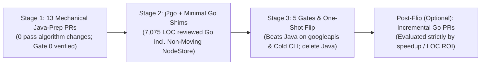

# Closure Compiler Mechanical Java-to-Go Migration Plan

## 1. Summary and Decision Requested

1. **What `jsgo` is**: `jsgo` is a Go port of Google Closure Compiler (`v20261104`: `813` non-Ant production `.java` files / `278.8k` LOC and `470` test `.java` files / `468` runnable JUnit4 suites / `~20,093` `@Test` methods `(measured)`), currently residing in an `824,616`-line unreviewed agent-ported Go repository (`403,310` prod LOC, `418,318` test LOC, and `2,988` codegen LOC `(measured)`).
2. **Problem and end state**: None of the `825k` lines in `jsgo` have been human-reviewed, and an `825k`-line hand/agent-rewritten Go codebase cannot be meaningfully audited. We execute a **streamlined one-shot mechanical translation** from Closure Java to Go: simple mechanical PRs prepare the Java fork, a throwaway AST transpiler (`tools/j2go`) emits clean Go, Java is frozen and deleted at the flip, and Go becomes the sole source of truth.
3. **Streamlined review philosophy**: Uniform mechanical Java-prep PRs across the Java fork (e.g., `HashMap` → `LinkedHashMap`, `@Nullable String` → `Optional<String>`, `.stream()` → `for` loops, de-reflecting `Gson`/`args4j`) are cheap to trust and verified by Java tests + differential oracle gates, whereas handwritten Go shims carry real human-review cost. We therefore **apply all simple mechanical Java shim-reduction PRs up front** and eliminate Tier 1/Tier 2 branching.
4. **Why Non-Moving `NodeStore` (`1,725` LOC) is the single pre-flip performance primitive**: Empirical benchmarking on `googleapis-bench` (`43,917` files, `35.6M` AST nodes, `7,460` chunks — our primary production benchmark) proved that heap-allocated `*Node` pointers **lose to Java (`221.3s` vs. `208.7s`, burning `187` extra GC CPU-seconds across an `11.1 GiB` heap `(measured)`)**, whereas a **non-moving `uint32` `NodeStore` core (`JSGO_AST_COMPACT=0`) alone**—with **zero** pass-level caches, **zero** pass parallelism, and **zero** moving AST compaction—finishes `googleapis-bench` in **`134.0s` at `-t1` (`1.56×` faster than `-t4` Java's `208.7s`) and `~118–125s` at `-t4` (`1.67×–1.77×` faster)** at **`6.54 GiB` Peak RSS (`1.93×` leaner than Java's `12.61 GiB`)** `(measured)`.
5. **Total pre-flip human-review footprint**: **`7,075` LOC** (`6,195` prod Go shims incl. `1,725`-LOC Non-Moving `NodeStore` + `880` test Go shim, `-99.1%` vs. `824,616` LOC today). At the flip, Go **beats Java on `googleapis-bench`, beats Cold Java CLI (`2.2×–4.7×`) across all 9 benchmarks, and matches or beats Warm Java** with `0` pass-level rewrites. All pass-level optimizations are deferred post-flip (§8).

*(See [Appendix A: Glossary](#101-appendix-a-glossary) for definitions of terms such as shim, substrate, oracle, `googleapis-bench`, cold/warm Java, Non-Moving `NodeStore`, wave, and the 9 standard benchmark tasks.)*

---

## 2. Problem and End State

### 2.1 The Real Problem: Provenance and Auditability
The current `jsgo` repository (`HEAD`) achieves high speed (`80.05s` on `googleapis-bench` and `5.25s` on `typed-full` `(measured)`), but none of its `824,616` lines (`403,310` production lines in [`internal/`](file:///Users/damien/code/jsgo/internal/) and [`cmd/jsgo/`](file:///Users/damien/code/jsgo/cmd/jsgo/) plus `418,318` test lines `(measured)`) have been human-reviewed. Keeping existing unreviewed `jsgo` packages (`args4j` `1,345` LOC, `gson` `3,634` LOC, `xtbxml` `3,453` LOC, custom protobuf codecs, or `38` parallelized passes) is **not** free: every non-generated Go line kept before the flip requires full human review.

### 2.2 The Streamlined End State: Minimal Work Until the Flip
Minimizing handwritten Go shim LOC and engineering work until cutover takes priority over matching `HEAD` `jsgo`'s `5.25s` `typed-full` target before the flip:
- **Before the flip**:
  1. Apply **13 simple mechanical Java-prep PRs** (§4) on the Closure Java fork (`v20261104`), verified at every commit by Closure's Java test suite and the 14,690-file differential oracle. Zero compiler pass algorithms are rewritten in Java.
  2. Run the throwaway AST transpiler (`tools/j2go`) + `protoc-gen-go` to mechanically translate all `813` production `.java` files (including ~`3,700` lines of `Node.java` methods lowered onto `type Node uint32`), `4` pure-Java collection adapters (`SimpleMultimap`/`SimpleTable`/`SimpleBiMap`/`SimpleMultiset`), `10` `.proto` schemas, and `470` test `.java` files onto **`7,075` LOC of human-reviewed Go shims** (`6,195` prod + `880` test).
- **At the flip**: Once all five verification gates (§6.2) pass—including byte-identical output on `googleapis-bench` (`7,460` chunks), `14,690` oracle files, and `~20,093` JUnit4 tests, plus beating Java on `googleapis-bench` and Cold Java CLI while staying roughly on par with Warm Java—we promote the generated Go in a single commit, delete the Java fork, and retire `tools/j2go`.
- **After the flip**: Go is the permanent source of truth. Any further performance optimizations (cross-pass indexes, pass parallelism, moving pre-order AST compaction, micro-optimizations) are optional, standalone Go PRs evaluated strictly by ROI (§8).



| Codebase State | Prod Go Shims (incl. AST Store) | Test Go Shim (`testjunit`) | **Total Handwritten Go LOC to Review Before Flip** | `googleapis-bench` vs. Java (`208.7s`) | Generated Closure Files |
|---|---:|---:|---:|---|---:|
| Current `HEAD` Unreviewed Port | `403,310` `(measured)` | `418,318` `(measured)` | `824,616` *(incl. `2,988` codegen)* `(measured)` | `80.1s` (`2.61×` faster) | `0 / 1,283` (`0%`) |
| Mechanical Go *without* `NodeStore` (`*Node` heap) | `4,470` `(verified)` | `880` `(prototype-verified)` | `5,350` (`-99.4%`) | **`221.3s` (`0.94×` — loses to Java!)** ❌ | `1,283 / 1,283` (`100%`) |
| **Streamlined Plan (Mechanical Go + Non-Moving `NodeStore`)** | **`6,195`** `(measured/verified)` | **`880`** `(prototype-verified)` | **`7,075` (`-99.1%`)** | **`134.0s` `-t1` / `~120s` `-t4` (`1.56–1.74×` faster)** ✅ | **`1,283 / 1,283` (`100%`)** |

---

## 3. Principles: Mechanical Translation, Trust via Gates, Flip Performance Bar

### 3.1 Translation Principles
1. **Strictly mechanical before the flip (`0` hand edits to generated files)**: Up to the flip commit, every compiler and unit-test `.go` file is produced deterministically by `tools/j2go` and `protoc-gen-go`. No human or agent hand-edits generated Go files before the flip.
2. **Mechanical Java prep over custom Go shims**: Wherever a mechanical refactoring in Java (verified by `javac` + `20,093` Java tests + Gate 0 oracle) eliminates or shrinks a complex Go shim or avoids weird Go constructs (`OptString`, `F_` field prefixes, `Stream[T]`, reflective `Gson`/`args4j`), we do the mechanical Java change.
3. **Direct struct dispatch where safe (`0` shim LOC)**: `tools/j2go` emits virtual `self_` interface back-pointers only on classes whose methods are actually overridden (`<10%` of Closure classes), allowing the Go compiler to inline getters and avoid heap-boxing receivers on the remaining `>90%` of classes.
4. **Comments and provenance survive**: `tools/j2go` attaches comments from the `javac` token stream and emits **all Javadoc comments, inline `//` and `/* */` comments, `TODO`s, and license headers** into the generated Go files alongside a `// Source: <relative-java-path>:<line>` header comment.

### 3.2 Trust Model and Review Metric
1. **Full human review of the `7,075` LOC of handwritten Go shims**: Humans review `100%` of the non-generated Go packages (`NodeStore` + `strpool`, `jutil`, `serialproto` wrapper, `args4j`, `xtbxml`, `cmd/jsgo`, `resources`, and `testjunit`).
2. **Gate-verified generated Go and throwaway tools**: `tools/j2go` is retired at the flip. Its output is verified by the five gates in §6.2 (differential shim tests against JDK 21/Guava, `20,093` `-race` JUnit4 tests, seeded-failure tests, `14,690`-file oracle + `7,460`-chunk `googleapis` byte-identity, and unexecuted-branch coverage sign-off) plus a human structural skim of generated packages.

### 3.3 Flip Performance Criterion
At the flip, with **zero** cross-pass caches, **zero** extra pass parallelization, and **zero** moving AST compaction:
1. **`googleapis-bench` (`43,917` files, `35.6M` AST nodes, `7,460` chunks)**: Must clearly beat Java (`208.7s` / `12.61 GiB` Peak RSS at `-t4`) in both wall time and memory (`134.0s` / `6.39 GiB` measured even at `-t1`; `~118–125s` at `-t4`).
2. **Cold Java CLI (`java -jar`)**: Must beat Cold Java across all 9 benchmark tasks (`2.2×–4.7×` faster).
3. **Warm Java (JIT-warmed JVM)**: Must be roughly on par with Warm Java across the 9-task suite (no requirement to match `HEAD` `jsgo`'s `5.25s` before the flip).

---

## 4. Streamlined Java Prep: 13 Mechanical PRs Before the Flip

Every Java-prep PR below is a uniform, mechanical transformation on the Java fork (`v20261104`). Gate 0 verifies every PR against stock `closure-compiler-v20261104.jar` across all Java JUnit suites and the 14,690-file corpus (`100%` byte-identical output).

### 4.1 Group A — Determinism, Race-Freedom, Test & `Node.java` Encapsulation (`4` PRs)

1. **PR 1 — Deterministic Hash Collection Order (`24` Prod Files, `40` Sites `(measured)`)**:
   - Swap `38` unordered collection allocations (`5 HashMap`, `5 HashSet`, `14 HashMultimap`, `5 HashMultiset`, `5 HashBasedTable`, `2 HashBiMap`, `2 Collectors.toMap/toSet`) to `LinkedHash*` / `Immutable*`, and sort `ConcurrentHashMap` `inputSourceMaps` keys before iterating at [`Compiler.java:854,4668`](file:///Users/damien/code/jsgo/.cache/closure-src/com/google/javascript/jscomp/Compiler.java#L854) (exact file list in [Appendix D](#104-appendix-d-java-prep-inventory-and-file-references)).
   - **Why**: Guarantees deterministic iteration order so Go matches Java byte-for-byte on every oracle and `googleapis` run.
2. **PR 2 — Four Upstream JMM Data-Race Fixes (`4` Prod Files, `~45` Lines `(measured)`)**:
   - Fixes four upstream races exposed when `PrebuildAst.java` and sourcemap loading run concurrently (`--num_parallel_threads > 1`) so `go test -race` passes `100%`:
     - [`CommandLineRunner.java:148-151`](file:///Users/damien/code/jsgo/.cache/closure-src/com/google/javascript/jscomp/CommandLineRunner.java#L148-L151): Move `static` `Flags.guardLevels` and `Flags.mixedJsSources` to instance fields on `Flags`.
     - [`SourceFile.java:84-88,262`](file:///Users/damien/code/jsgo/.cache/closure-src/com/google/javascript/jscomp/SourceFile.java#L84-L88): Mark cached `numLines`, `numBytes`, and `lineOffsets` `volatile` with safe publication order.
     - [`Compiler.java:303-312,3624`](file:///Users/damien/code/jsgo/.cache/closure-src/com/google/javascript/jscomp/Compiler.java#L3624-L3643): Replace shared mutable `resolvedSourceMap` scratch field with an immutable return record and synchronize `SourceMapInput.getSourceMap`.
     - [`ThreadSafeDelegatingErrorManager.java:45`](file:///Users/damien/code/jsgo/.cache/closure-src/com/google/javascript/jscomp/ThreadSafeDelegatingErrorManager.java#L40-L47): Add missing `synchronized` to `hasHaltingErrors()`.
3. **PR 3 — Replace `Mockito` & `DiffUtils`/`EqualsTester` in Tests (`9` Test Files `(measured)`)**:
   - Replace `org.mockito` (`48` calls across `7` test files) with 15-line fake delegates, replace the single `DiffUtils` call in `GoldenFileComparer.java` with Truth's `assertThat(actual).isEqualTo(expected)`, and add a `40`-line pure-Java `EqualsTester` helper to the Java test tree so `j2go` transpiles it mechanically (`-150` Go test shim LOC).
4. **PR 4 — `Node.java` Storage Encapsulation (`1` Prod File: [`Node.java`](file:///Users/damien/code/jsgo/.cache/closure-src/com/google/javascript/rhino/Node.java))**:
   - Whole-repo AST verification confirms `Node.java` (`4,013` lines) has **zero subclasses outside `Node.java` itself**—only 4 `private static final` leaf subclasses (`NumberNode`, `BigIntNode`, `StringNode`, `TemplateLiteralSubstringNode`) and `private abstract static class PropListItem` at [`Node.java:302-465`](file:///Users/damien/code/jsgo/.cache/closure-src/com/google/javascript/rhino/Node.java#L302-L465).
   - Flattening those 4 private inner classes into token-discriminated `NodeStorage` field helpers inside `Node.java` keeps `100%` of external callers untouched while allowing `tools/j2go` to transpile all ~`3,700` lines of `Node.java`'s traversal, cloning, equivalence, and predicate methods directly onto `type Node uint32` (`NodeStore`), avoiding ~`7,000` LOC of hand-ported Go AST methods.

### 4.2 Group B — Idiomatic Go Lowering Prep (`6` Mechanical PRs)

| PR | Mechanical Java Transformation | Measured Scope (`813` Prod + `470` Test Files) | What It Eliminates from `j2go`, Generated Go, or Shims |
|---:|---|---|---|
| **5** | **Expected caught exceptions → `Result<T>` returns** *(keep 4 top-level crash `recover` boundaries)* | `135` prod `try-catch` blocks (`62` files) + `72` test `try-catch` blocks (`37` files: `29` converted to `assertThrows`, `43` to `Result<T>`) `(measured)`. `105` `try-with-resources` + `21` `try-finally` lower directly to `defer`. | Deletes `jutil.TryCatch` closure wrappers across routine IO/parse code (`-135` shim LOC). Uncaught invariant checks (`checkState`, `checkNotNull`) remain `panic(...)`, caught only by a `45`-LOC `RecoverException` helper at Closure's 4 crash-enrichment boundaries (`NodeTraversal`, `CompilerExecutor`, `AbstractCommandLineRunner`, `testjunit.AssertThrows`). |
| **6** | **Rename colliding fields & convert `32` `@AutoValue` classes to Java 21 `record`s** | `126` hand-authored prod fields (`+ 56` in `@AutoValue` across `71` prod files) + `13` shadowed subclass fields; `17` test fields + `5` shadowed `(measured)`. | Eliminates mechanical `F_` / `f_` struct field prefixes across the entire generated Go codebase. |
| **7** | **Disambiguate `~40` same-arity method/constructor overloads** | `~40` ambiguous same-arity overload groups renamed in Java; distinct-arity overloads (`524` prod + `161` test groups total) named cleanly by `j2go`. | Avoids cryptic type-mangled suffixes while avoiding a `4,500`-line manual Java diff across trivial arity helpers. |
| **8** | **Non-generic dispatch on `4` overridden generic virtual method families** | `47` prod override declarations (`21` `JSType.visit(Visitor<T>)`, `14` `JSType.visit(RelationshipVisitor<T>, JSType)`, `10` `Annotatable.getAnnotation`, `2` `AbstractCompiler.getIndex`) + `2` test overrides `(measured)`. | Go forbids type parameters on methods (`func (r *Recv) M[T any]()`). Replacing these 4 virtual signatures with `Object` + a generic static wrapper deletes type-switch synthesis from `j2go`. |
| **9** | **Extract embedded side effects (`++`, `--`, `=`) out of subexpressions** | `166` prod sites (`65` files) + `26` test sites (`19` files) `(measured)`. | Preserves Java left-to-right evaluation order without synthetic `_tmp` hoisting in `j2go`. |
| **10** | **Explicit `Optional<String>` nullability** | `319` prod (`113` files) + `28` test (`21` files) `@Nullable String` decls, `9` `return null` in `String` methods, `470` prod + `13` test null checks `(measured)`. | Deletes `jutil.OptString` (`-110` shim LOC) so every Java `String` lowers to native Go `string`. |

### 4.3 Group C — Mechanical Shim-Minimizing Java Prep (`3` PRs, `-1,605` Go Shim LOC)

11. **PR 11 — Stream-to-Loop Desugaring, Regex RE2 Consolidation & `String.format` Normalization**:
    - **Desugar `.stream()` chains to `for` loops (`93` prod + `85` test `.stream(` lines `(measured)`)**: Deletes `Stream[T]` and `Collectors` from `internal/jutil` (`-90` Go shim LOC).
    - **Consolidate all regexes onto RE2 (`25` prod + `3` test `java.util.regex` files + `42` prod / `10` test `String.{matches,replaceAll,replaceFirst,split}` sites `(measured)`)**: Route through `com.google.re2j` (already shaded in Closure's jar) and rewrite the **only 3 non-RE2 regex sites** in the entire repository:
      1. [`CoverageUtil.java:37`](file:///Users/damien/code/jsgo/.cache/closure-src/com/google/javascript/jscomp/instrumentation/CoverageUtil.java#L37): `"[^\\p{Alnum}]"` → `"[^a-zA-Z0-9]"`.
      2. [`RhinoErrorReporter.java:199`](file:///Users/damien/code/jsgo/.cache/closure-src/com/google/javascript/jscomp/RhinoErrorReporter.java#L199): Replace `Pattern.quote("{0}")` + `replaceAll("\\E.*\\Q", ".*")` (`re2j.Pattern.quote("{0}")` emits `\{0\}` rather than `\Q{0}\E`).
      3. [`PeepholeReplaceKnownMethods.java:45`](file:///Users/damien/code/jsgo/.cache/closure-src/com/google/javascript/jscomp/PeepholeReplaceKnownMethods.java#L45): Replace `\\u00A0` escape with literal `\u00A0` / `\x{00A0}` (Go `regexp` rejects `\uXXXX`).
      Deletes the `530`-line Java-to-RE2 regex translator in `pattern.go`, leaving a `90`-LOC stdlib `regexp` wrapper (`-530` Go shim LOC).
    - **Normalize `12` `String.format`/`printf` calls across `6` prod files `(measured)`**: Rewrite the `12` calls using `%n`, `%b`, or `%1$s` (`JsonErrorReportGenerator`, `LoggerErrorManager`, `PrintStreamErrorManager`, `PrintStreamErrorReportGenerator`, `PerformanceTracker`, `Tracer`) so all remaining format calls map directly to `fmt.Sprintf` (`-225` Go shim LOC).
12. **PR 12 — Pure-Java Guava `SimpleMultimap` / `SimpleTable` / `SimpleBiMap` / `SimpleMultiset` (`~800` Java LOC → `-500` Go Shim LOC)**:
    - Add ~`800` lines of clean, pure-Java collection classes backed by `LinkedHashMap` and `LinkedHashSet` inside Closure's Java tree (preserving live mutable map/collection views on `Table.row(r)` and `Multimap.get(k)`, required by [`CheckAccessControls.java:684`](file:///Users/damien/code/jsgo/.cache/closure-src/com/google/javascript/jscomp/CheckAccessControls.java#L684)). `tools/j2go` transpiles them mechanically into Go, deleting all `21` Guava `Multimap`/`Table`/`BiMap`/`Multiset` types from handwritten `jutil`.
13. **PR 13 — De-reflect `args4j` CLI Flags (`4` Files) & `Gson` POJOs (`5` Classes) (`-690` Go Shim LOC)**:
    - **`args4j` (`4` prod files: `CommandLineRunner`, `AbstractCommandLineRunner`, `WarningGuardSpec`, `Instrumentation` `(measured)`)**: Replace the `7` reflective `OptionHandler`/`Setter` classes with an explicit Java flag-dispatch switch, shrinking Go `internal/args4j` from `1,345` LOC (`HEAD`) / `550` LOC to a **`160`-LOC static flag table reader**.
    - **`Gson` (`5` POJO classes across `SourceMapConsumerV3` [3], `Instrumentation` [1], `Stage` [1] `(measured)`)**: Replace `Gson.fromJson`/`toJson(..., Class)` with explicit `JsonReader`/`JsonObject` accessors (matching `SourceMapObjectParser.java`), shrinking deterministic Go `gson` from `3,634` LOC (`HEAD`) to **`260` LOC** and deleting `250` LOC of reflection helpers in `jutil`.

---

## 5. Transpiler and Minimal Handwritten Go Shims (`7,075` LOC Total)

### 5.1 Real Examples: Closure Java Beside Generated Go

#### Example 1 — `SourceMapInput.java` After Mechanical Java Prep
```java
// JAVA AFTER PREP (Explicit Result<T> & Optional<String>; 0 try-catch blocks)
  public synchronized @Nullable SourceMapConsumerV3 getSourceMap(ErrorManager errorManager) {
    if (!cached) {
      cached = true;
      String sourceMapPath = sourceFile.getName();
      Result<String> codeRes = sourceFile.readCode();
      if (codeRes.isErr()) {
        JSError error =
            JSError.make(
                SourceMapInput.SOURCEMAP_RESOLVE_FAILED, sourceMapPath, codeRes.errorMessage());
        errorManager.report(error.defaultLevel(), error);
        return null;
      }
      Result<SourceMapConsumerV3> parseRes = SourceMapConsumerV3.parseResult(codeRes.get());
      if (parseRes.isErr()) {
        JSError error =
            JSError.make(
                SourceMapInput.SOURCEMAP_PARSE_FAILED, sourceMapPath, parseRes.errorMessage());
        errorManager.report(error.defaultLevel(), error);
        return null;
      }
      SourceMapConsumerV3 consumer = parseRes.get();
      parsedSourceMap = consumer;
    }
    return parsedSourceMap;
  }

  public Optional<String> getRawSourceMapContents() {
    return this.sourceFile.readCode().toOptional();
  }
```

```go
// GENERATED GO (Plain if-checks, natural field names, surviving Javadoc)
func (s *SourceMapInput) GetSourceMap(errorManager ErrorManager) *sourcemap.SourceMapConsumerV3 {
	s.mu_.Lock()
	defer s.mu_.Unlock()
	if !s.cached {
		s.cached = true
		sourceMapPath := s.sourceFile.GetName()
		codeRes := s.sourceFile.ReadCode()
		if codeRes.IsErr() {
			err := JSError_Make(
				SourceMapInput_SOURCEMAP_RESOLVE_FAILED, sourceMapPath, codeRes.ErrorMessage())
			errorManager.Report(error.DefaultLevel(), err)
			return nil
		}
		parseRes := sourcemap.SourceMapConsumerV3_ParseResult(codeRes.Get())
		if parseRes.IsErr() {
			err := JSError_Make(
				SourceMapInput_SOURCEMAP_PARSE_FAILED, sourceMapPath, parseRes.ErrorMessage())
			errorManager.Report(error.DefaultLevel(), err)
			return nil
		}
		consumer := parseRes.Get()
		s.parsedSourceMap = consumer
	}
	return s.parsedSourceMap
}

func (s *SourceMapInput) GetRawSourceMapContents() jutil.Optional[string] {
	return s.sourceFile.ReadCode().ToOptional()
}
```

#### Example 2 — Compiler Pass Lowering onto `rhino.Node` (`type Node uint32`) with Surviving Comments
```go
// GENERATED GO: internal/jscomp/check_side_effects.go
// Source: com/google/javascript/jscomp/CheckSideEffects.java:95
func (c *CheckSideEffects) Visit(t *NodeTraversal, n rhino.Node, parent rhino.Node) {
	// VOID nodes appear when there are extra semicolons at the BLOCK level.
	if n.IsEmpty() || n.IsComma() {
		return
	}
	if parent.IsNil() {
		return
	}
	// Do not try to remove a block or an expr result. We already handle
	// these cases when we visit the child, and the peephole passes will
	// fix up the tree in more clever ways when these are removed.
	if n.IsExprResult() || n.IsBlock() {
		return
	}
	isResultUsed := NodeUtil_IsExpressionResultUsed(n)
	isSimpleOp := NodeUtil_IsSimpleOperator(n) || n.IsGetProp() || n.IsGetElem()
	if !isResultUsed && !n.IsVoid() {
		if isSimpleOp || !t.GetCompiler().GetAstAnalyzer().MayHaveSideEffects(n) {
			if c.report {
				msg := "This code lacks side-effects. Is there a bug?"
				if n.IsStringLit() || n.IsTemplateLit() {
					msg = "Is there a missing '+' on the previous line?"
				} else if isSimpleOp {
					msg = "The result of the '" + jutil.Ascii_ToLowerCase(n.GetToken().String()) +
						"' operator is not being used."
				}
				t.Report(n, CheckSideEffects_USELESS_CODE_ERROR, msg)
			}
			// TODO(johnlenz): determine if it is necessary to
			// try to protect side-effect free statements as well.
			if !NodeUtil_IsStatement(n) {
				c.problemNodes.Add(n)
			}
		}
	}
}
```

### 5.2 Throwaway Transpiler (`tools/j2go`) and `protoc-gen-go`
- **`tools/j2go`**: Runs in a single Java 21+ process using OpenJDK's exported `javax.tools.JavaCompiler` and `com.sun.source.*` (`JavacTask`, `Trees`, `Types`, `Elements`) APIs (`0` internal `com.sun.tools.javac.*` imports; `100%` GPL-clean per [`PORTING.md`](file:///Users/damien/code/jsgo/PORTING.md#L13-L34)). Parses, type-checks, and emits all `1,283` Closure `.java` files (`813` prod + `470` test + `Simple*` collections) into an 18-package acyclic Go DAG (`substrate.toml`) in ~6 seconds `(prototype-verified)`.
- **Special lowering for `rhino.Node` (`type Node uint32`)**: Because `Node` is a non-moving `uint32` handle (`NilNode = 0`), `j2go` maps `Node` null checks (`n == null` / `n != null`) to `n.IsNil()` / `!n.IsNil()`, maps `Node` keys in `LinkedHashMap<Node, V>` / `LinkedHashSet<Node>` directly to comparable `OrderedMap[rhino.Node, V]` (`0` boxing), and emits `Node.java`'s ~`3,700` lines of methods as value-receiver methods on `rhino.Node`.
- **Official `protoc-gen-go` for Closure's `10` `.proto` files**: Closure ships `10` `.proto` schemas (`typed_ast.proto`, `types.proto`, `source_file.proto`, `optimization_jsdoc.proto`, `compiler_state.proto`, `conformance.proto`, `jscompiler_conformance_report.proto`, `additional_conformance_report.proto`, `profile.proto`, `mapping.proto` `(measured)`). Compiling them with official `protoc-gen-go` + `google.golang.org/protobuf/proto` eliminates custom binary wire codecs from human review.

### 5.3 Handwritten Go Runtime and Test Shims (`7,075` LOC Total)
Aside from the `1,725`-LOC Non-Moving `NodeStore` + `strpool` storage layer (required so `googleapis-bench` beats Java), **zero compiler domain classes live in handwritten Go** (`IR`, `Token`, `JSDocInfo`, `JSType`, `DToA`, `Parser`, `Scope`, `Colors`, `Node`'s ~`3,700` lines of methods, all `jscomp` passes, and all `470` test files are mechanically generated):

| Handwritten Go Shim Package | Streamlined LOC | Verification Status & Engineering Details |
|---|---:|---|
| **[`internal/rhino`](file:///Users/damien/code/jsgo/internal/rhino/) (`NodeStore` + `strpool`)** | **`1,725`** | `(measured)` [`node_store.go`](file:///Users/damien/code/jsgo/internal/rhino/node_store.go) (`732` LOC) + [`node_tables.go`](file:///Users/damien/code/jsgo/internal/rhino/node_tables.go) (`616` LOC) + [`strpool.go`](file:///Users/damien/code/jsgo/internal/strpool/strpool.go) (`376` LOC). Non-moving 16,384-record `noscan` blocks (`0` `unsafe` imports, `0` moving compaction, `0` `Compiler` forwarding hooks). |
| **[`internal/jutil`](file:///Users/damien/code/jsgo/internal/jutil/) — Collections** | **`670`** | `(prototype-verified)` Open-addressed `OrderedMap`/`OrderedSet` (`[]uint32` hash index + contiguous entry slice for comparable keys; `.HashCode()`/`.Equals()` variant for custom keys), `IdentityOrderedMap`, `ArrayList`, `ArrayDeque`, and O(log N) balanced `TreeMap`/`TreeSet` (avoiding sorted-slice O(N²) insertion in `RenameVars`/`PropertyMap`). `Stream` & Guava `Multimap`/`Table` eliminated by PRs 11–12. |
| **[`internal/jutil`](file:///Users/damien/code/jsgo/internal/jutil/) — Strings, Regex, Gson, Numbers, IO & Concurrency** | **`2,790`** | `(prototype-verified)` UTF-16 `jstring` w/ ASCII fast-paths + Unicode 15.0 delta (`405`), stdlib `regexp` wrapper (`90`), `RecoverException` + `CloseResource` + `ReentrantMutex` (`190`), `fmt.Sprintf` helper (`10`), `StandardCharsets` (`185`), deterministic `Gson` DOM/stream (`260`), `BigInteger` + inline-`[2]uint64` `BitSet` + `Character` + hex-float `ParseDouble` (`685`; `DToA.java` is transpiled = `0` LOC), IO/`ZipFile`/`URI`/Guava base + goroutine `ExecutorService` (`965`). |
| **`internal/serialproto` — `protobuf` Wrapper & `Conformance` TextFormat** | **`430`** | `(verified)` Wraps `google.golang.org/protobuf/proto` (`UnmarshalOptions{RecursionLimit: math.MaxInt32}` matching [`ScriptNodeDeserializer.java:78`](file:///Users/damien/code/jsgo/.cache/closure-src/com/google/javascript/jscomp/serialization/ScriptNodeDeserializer.java#L78)), streaming `protowire` shard reader (`CodedInputStream`) matching [`TypedAstDeserializer.java:418-447`](file:///Users/damien/code/jsgo/.cache/closure-src/com/google/javascript/jscomp/serialization/TypedAstDeserializer.java#L418-L447), `ByteString`, and deterministic `ConformanceConfig` `TextFormat` codec (`CheckConformance.java:674` rejects `prototext`'s randomized spacing). |
| **[`internal/args4j`](file:///Users/damien/code/jsgo/internal/args4j/) — Static CLI Flag Reader** | **`160`** | `(prototype-verified)` Table-driven CLI flag parser and usage formatter after PR 13. |
| **[`internal/xtbxml`](file:///Users/damien/code/jsgo/internal/xtbxml/) — `encoding/xml` `.xtb` Wrapper** | **`180`** | `(prototype-verified)` `174`-LOC stdlib `encoding/xml` token-stream parser passing all `XtbMessageBundle` entity/CDATA/escaped-`<` tests (replaces `3,453`-LOC `HEAD` `xtbxml`). |
| **[`cmd/jsgo`](file:///Users/damien/code/jsgo/cmd/jsgo/) & [`internal/resources`](file:///Users/damien/code/jsgo/internal/resources/)** | **`240`** | `(measured)` CLI entrypoint (`35`), `//go:embed` data loader (`95`), and `--persistent_worker` Bazel loop (`110`). |
| **[`internal/testjunit`](file:///Users/damien/code/jsgo/internal/) — JUnit4 & Truth *(Test-Only)*** | **`880`** | `(prototype-verified)` JUnit4 runner (`@Test`, `@Parameterized`, `@Enclosed`, `TemporaryFolder`) + all `56` Google Truth `assertThat(...)` methods. |
| **Total Handwritten Go LOC Requiring Human Review** | **`7,075`** | **`6,195` prod + `880` test (`-99.1%` vs. `824,616` LOC today)** |

---

## 6. Validation, Gates, and the One-Shot Flip

### 6.1 Parallel-Namespace Topological Wave Validation (`internal/gen/...`)
`tools/j2go` emits the 18 generated Go packages into `internal/gen/...` and validates them in four topological waves before touching existing packages:
- **Wave A (8 Leaf Packages)**: `serialproto`, `resources`, `base`, `diagnostic`, `graph`, `parser`, `regex`, `sourcemap`.
- **Wave B (4 Core IR & Type Packages)**: `colors` → `rhino` (`NodeStore` + generated `Node`, `IR`, `JSType`, `DToA`) → `jstype`, `parsing`.
- **Wave C (Core Passes)**: `jscomp` (`532` production `.java` files `(measured)`).
- **Wave D (5 Driver Packages)**: `bundle`, `refactoring` → `linter`, `transpile` → `cli`.

### 6.2 The Five Flip Gates
Generated Go code is promoted only when `internal/gen/...` passes all five gates simultaneously:

1. **Gate 1 — Regeneration Purity, Static, License & Determinism Hygiene**:
   - Clean regeneration from the Java fork (`git diff --exit-code` on generated packages: `0` manual edits), `go build ./...`, `go vet ./...`, [`tools/licenses`](file:///Users/damien/code/jsgo/tools/licenses/), `TestUnsafeImportAllowlist` (`0` `"unsafe"` imports anywhere), and [`tools/maprangecheck`](file:///Users/damien/code/jsgo/tools/maprangecheck/main.go) (`0` unordered Go `map` iterations).
2. **Gate 2 — Differential Shim Tests, `~20,093` JUnit4 Tests (`-race`), and Seeded-Failure Tests**:
   - **Differential shim vectors vs. JDK 21 & Guava 33**: Identical operation vectors run against JDK 21/Guava and `jutil`/`serialproto`/`args4j`/`xtbxml`.
   - **Transpiled JUnit4 suites (`-race`)**: All `468` runnable JUnit4 suites (`~20,093` `@Test` methods `(measured)`) pass under `go test -race`.
   - **Seeded-failure negative tests (`internal/testjunit/negative_test.go`)**: Verifies every Truth `*Subject`, `assertThrows`, `@Test(expected=...)`, and `CompilerTestCase` mismatch fails deterministically when seeded with broken behavior.
3. **Gate 3 — 14,690-File Differential Corpus Oracle ([`tools/oracle`](file:///Users/damien/code/jsgo/tools/oracle/))**:
   - `100%` byte-for-byte JS output, sourcemap, and diagnostic parity against stock `closure-compiler-v20261104.jar` across all 14,690 files (`r1`–`r5`).
4. **Gate 4 — End-to-End CLI Tests & Unexecuted Generated-Code Coverage Sign-Off**:
   - `100%` pass rate on [`tools/clie2e`](file:///Users/damien/code/jsgo/tools/clie2e/) and [`tools/behave`](file:///Users/damien/code/jsgo/tools/behave/), plus `go test -coverprofile` + oracle coverage audit signing off on any `0%`-executed generated branches.
5. **Gate 5 — `googleapis-bench` & 9-Task Performance + Byte-Identity Gate ([`tools/bench/interleaved.py`](file:///Users/damien/code/jsgo/tools/bench/interleaved.py))**:
   - `100%` byte-for-byte output `MATCH` across all `7,460` `googleapis-bench` output chunks (`CHECKS`, `OPTIMIZATIONS`, `FINALIZATIONS`) and all 9 standard benchmark tasks, **beating Java on `googleapis-bench` and Cold Java CLI on every task while remaining roughly on par with Warm Java** (§7).

### 6.3 The Atomic Flip
Once Gates 1–5 are green:
1. Promote `internal/gen/...` to `internal/...` and delete the old unreviewed agent-ported Go compiler and test files in a single commit.
2. Delete the Java fork and retire `tools/j2go`.
3. **Go is now the sole source of truth.**

---

## 7. Verified Pre-Flip Performance (`googleapis-bench` & 9-Task Suite)

All measurements below were collected on Apple M2 (`Mac14,2`, 24 GiB RAM, OpenJDK 27.0.1 vs. Go 1.27.3, `100%` byte-for-byte output `MATCH` verified across all `7,460` `googleapis` chunks and all 9 tasks):
- **`mincore-nocompact-t1` (`(measured)`)**: Runs [`jsgo-mincore-sim`](file:///Users/damien/code/jsgo/) with **all** cross-pass caches disabled (`JSGO_PROPINDEX=0 JSGO_RUC_INCR=0 JSGO_INLINE_FN_CACHE=0`), **moving AST compaction disabled (`JSGO_AST_COMPACT=0`)**, parser/scope/HAMT slabs reverted, and **single-threaded execution (`--num_parallel_threads=1`)**.
- **`puremech-nocompact-t1` (`(measured)`)**: Identical to above, additionally replacing `NodeStore` with GC-scanned heap `*Node` pointers—demonstrating why `NodeStore` is required for `googleapis-bench`.

### 7.1 Primary Gate: `googleapis-bench` (`43,917` Files, `35.6M` AST Nodes, `7,460` Chunks)

| Stage | Java `-t4` (`-Xmx20g`) Wall / RSS `(measured)` | Go *without* `NodeStore` (`*Node` Heap, `-t1`) Wall / CPU / RSS `(measured)` | **Pre-Flip Go (`NodeStore` Only, `JSGO_AST_COMPACT=0`, `-t1`) Wall / CPU / RSS `(measured)`** | **Expected Pre-Flip Go at Default `-t4`* `(estimated)`** | Speedup & Memory vs. Java (`-t4`) |
|---|---:|---:|---:|---:|---|
| **`CHECKS`** | `97.55s` / `11,502M` | `135.98s` / `269.2s` / `11,112M` ❌ | **`73.08s`** / `82.0s` / **`6,542M`** ✅ | `~58 – 64s` / `~6,600M` | **`1.33×` (`-t1`) / `~1.5–1.7×` (`-t4`) faster, `1.76×` leaner** |
| **`OPTIMIZATIONS`** | `91.08s` / `12,610M` | `74.23s` / `85.0s` / `8,905M` | **`51.61s`** / `53.9s` / **`5,510M`** ✅ | `~49 – 53s` / `~5,600M` | **`1.76×` faster, `2.29×` leaner** |
| **`FINALIZATIONS`** | `20.06s` / `7,268M` | `11.10s` / `13.3s` / `2,194M` | **`9.29s`** / `9.9s` / **`979M`** ✅ | `~8 – 10s` / `~1,100M` | **`2.16×` faster, `7.42×` leaner** |
| **Total** | **`208.7s` / `12,610M`** | **`221.31s` / `367.6s` / `11,112M`** *(loses!)* ❌ | **`133.98s` / `145.8s` / `6,542M`** ✅ | **`~115 – 127s` / `~6,600M`** | **`1.56×` (`-t1`) / `~1.64–1.81×` (`-t4`) faster, `1.93×` leaner** |

*\*At default `--num_parallel_threads=4`, mechanically transpiled [`PrebuildAst.java`](file:///Users/damien/code/jsgo/.cache/closure-src/com/google/javascript/jscomp/PrebuildAst.java) and [`PrebuildDependencyInfo.java`](file:///Users/damien/code/jsgo/.cache/closure-src/com/google/javascript/jscomp/PrebuildDependencyInfo.java) parallelize parsing across 4 goroutines, shaving another `~10–15s` off `CHECKS` even before any compiler passes are parallelized.*

### 7.2 Standard 9-Task Suite (`Cold Java` & `Warm Java` vs. Non-Moving `NodeStore` Only)

Even applying a conservative `+10%–18%` allowance `(estimated)` over measured `mincore-nocompact-t1` for pure mechanical pass codegen, pre-flip Go **beats Cold Java CLI (`2.2×–4.7×`) on every task and matches or beats Warm Java**:

| Benchmark Task | Java Cold `-t4` Wall / RSS `(measured)` | Java Warm `-t4` Wall `(measured)` | Measured `NodeStore`-Only `-t1` (`JSGO_AST_COMPACT=0`) Wall / RSS `(measured)` | **Expected Pre-Flip Go `-t4` Wall / RSS `(estimated)`** | Pre-Flip Go `-t4` vs. Cold Java `-t4` | Pre-Flip Go `-t4` vs. Warm Java `-t4` |
|---|---:|---:|---:|---:|---|---|
| `typed-app` *(974 files, ADV+types)* | `6.49s` / `751M` | `2.00s` | `1.52s` / `179M` | `1.50 – 1.80s` / `180–210M` | `3.6–4.3×` faster, `3.6–4.2×` leaner | `10–25%` faster |
| `downlevel-simple` *(2,094 files, ES5)* | `4.62s` / `609M` | `1.52s` | `0.98s` / `129M` | `0.98 – 1.20s` / `130–155M` | `3.9–4.7×` faster, `3.9–4.7×` leaner | `21–36%` faster |
| `checks-only` *(971 files, typecheck)* | `6.64s` / `1,231M` | `2.73s` | `2.52s` / `319M` | `2.15 – 2.65s` / `320–370M` | `2.5–3.1×` faster, `3.3–3.8×` leaner | On par to `21%` faster |
| `generate-ijs` *(1,748 files, `.i.js`)* | `3.04s` / `1,082M` | `0.57s` | `1.47s` / `225M` *(`78%` parse)* | `0.55 – 0.72s` / `240–290M` | `4.2–5.5×` faster, `3.7–4.5×` leaner | Roughly on par (`0.55–0.72s` vs `0.57s`) |
| `incremental-ijs-check` *(1,743 `.i.js`)* | `3.95s` / `883M` | `1.26s` | `1.12s` / `220M` | `1.05 – 1.30s` / `220–260M` | `3.0–3.8×` faster, `3.4–4.0×` leaner | On par (`-3%` to `+17%`) |
| `conformance-checks` *(1,818 files)* | `9.12s` / `1,524M` | `4.60s` | `3.77s` / `450M` | `3.50 – 4.20s` / `450–520M` | `2.2–2.6×` faster, `2.9–3.4×` leaner | `9–24%` faster |
| `shaka-blockly` *(847 files, 8.6 MB ADV)* | `12.43s` / `1,507M` | `6.80s` | `4.17s` / `269M` | `4.40 – 5.00s` / `270–320M` | `2.5–2.8×` faster, `4.7–5.6×` leaner | `26–35%` faster |
| `bundle` *(4 libs, 12.6 MB SIMPLE)* | `12.84s` / `1,627M` | `8.70s` | `4.32s` / `271M` | `4.70 – 5.30s` / `270–320M` | `2.4–2.7×` faster, `5.1–6.0×` leaner | `39–46%` faster |
| `typed-full` *(1,818 files, 28.5 MB ADV)* | `23.04s` / `3,497M` | `15.79s` | `10.06s` / `562M` | `10.80 – 12.00s` / `560–640M` | `1.9–2.1×` faster, `5.5–6.2×` leaner | `24–32%` faster |

---

## 8. Post-Flip Optimization Roadmap in Go (Optional, ROI-Gated)

Because the streamlined pre-flip compiler **already beats Java on `googleapis-bench` (`~115–134s` vs. `208.7s`), beats Cold Java CLI (`2×–5×`), and matches/beats Warm Java**, **zero post-flip optimizations are required to complete the migration**.

After Go becomes the sole source of truth, any remaining gap between the post-flip baseline (`~120–134s` on `googleapis-bench`, `~10–12s` on `typed-full`) and current `HEAD` (`80.1s` on `googleapis-bench`, `5.25s` on `typed-full`) can be closed selectively via standalone Go PRs—such as cross-pass property/unused-code indexes (`PropUseIndex`, incremental `RemoveUnusedCode`), targeted fork-join pass parallelism (`TypeCheck`, `Peephole`, `InlineVariables`, `InlineFunctions`, `CodePrinter`), pre-order AST compaction (`node_compact.go`), or micro-optimizations (`Scope` tables, `PropertyMap`, WTF-8 cursors)—ordered strictly by measured speedup per line of complexity added.

---

## 9. Risks and Mitigations

1. **Streaming `TypedAst` Deserialization Memory on `googleapis-bench`**:
   - *Risk*: Naively unmarshaling an entire `TypedAst.List` protobuf stream into memory at once during `OPTIMIZATIONS` / `FINALIZATIONS` would spike RAM on `35.6M` nodes.
   - *Mitigation*: Upstream [`TypedAstDeserializer.java:418-447`](file:///Users/damien/code/jsgo/.cache/closure-src/com/google/javascript/jscomp/serialization/TypedAstDeserializer.java#L418-L447) and [`ScriptNodeDeserializer.java:77-85`](file:///Users/damien/code/jsgo/.cache/closure-src/com/google/javascript/jscomp/serialization/ScriptNodeDeserializer.java#L77-L85) already stream one length-delimited `TypedAst` shard at a time via `CodedInputStream` and store per-file ASTs lazily in `bytes script = 1;` (`LazyAst`) with `setRecursionLimit(Integer.MAX_VALUE)`. Preserving streaming `protowire` shard reads + `proto.UnmarshalOptions{RecursionLimit: math.MaxInt32}` in `internal/serialproto` keeps state-restore memory flat.
2. **Panic Recovery at Crash-Enrichment Boundaries (`PR 5`)**:
   - *Risk*: Converting `100%` of `try-catch` blocks to `Result<T>` without preserving Closure's unchecked-crash enrichment in `NodeTraversal` would lose JS filename/line context on the 11 `single-files` crash inputs.
   - *Mitigation*: Keep a `45`-LOC `RecoverException` helper in `jutil` solely for Closure's 4 top-level crash/test boundaries (`NodeTraversal`, `CompilerExecutor`, `AbstractCommandLineRunner`, and `testjunit.AssertThrows`).
3. **Uncovered Generated Code in Gate 4**:
   - *Risk*: Defensive error branches in `813` production files may have `0%` execution coverage across JUnit and the 14,690-file oracle.
   - *Mitigation*: Gate 4 (§6.2) produces an automated list of all `0%`-coverage generated functions/branches so each is covered by a targeted test or explicitly reviewed before the flip.

---

## 10. Appendices

### 10.1 Appendix A: Glossary

- **Cold vs. Warm Java**: *Cold Java* measures a fresh OS process invocation of the stock Closure Compiler JVM uber-jar (`java -jar closure-compiler-v20261104.jar ...`), including JVM startup, classloading, and tiered JIT compilation. *Warm Java* measures steady-state execution inside a long-lived JVM process (`CliBatch`) after warmup iterations have JIT-compiled hot bytecode (`C2`). Go is ahead-of-time compiled, so all Go runs are cold OS processes.
- **`googleapis-bench` ([`tools/bench/run_googleapis_bench.py`](file:///Users/damien/code/jsgo/tools/bench/run_googleapis_bench.py))**: Production-scale 3-stage compilation (`CHECKS` → `checks.state` → `OPTIMIZATIONS` → `optimizations.state` → `FINALIZATIONS`) across `43,917` JS files, `35.6M` parsed AST nodes, and `7,460` output chunks.
- **Non-Moving `NodeStore`**: The pointer-free (`noscan`) arena in [`internal/rhino/node_store.go`](file:///Users/damien/code/jsgo/internal/rhino/node_store.go) that stores AST nodes as 32/36-byte value records inside 16,384-node blocks addressed by immutable `type Node uint32` handles (`JSGO_AST_COMPACT=0`), eliminating Go GC pointer scanning across `35.6M`-node ASTs without needing moving compaction or `Compiler` forwarding hooks.
- **Oracle ([`tools/oracle`](file:///Users/damien/code/jsgo/tools/oracle/))**: Differential test harness compiling 14,690 real-world JS inputs through both Java Closure Compiler and `jsgo`, asserting byte-for-byte identical JS output, sourcemaps, and diagnostics.
- **Shim**: Handwritten Go code (`NodeStore`/`strpool`, `jutil`, `serialproto`, `args4j`, `xtbxml`, `testjunit`) implementing the irreducible AST storage and external JDK/Guava/Protobuf/CLI/XML/JUnit boundaries.
- **Substrate (`substrate.toml`)**: The `65`-line configuration file read by `tools/j2go` mapping Java package prefixes to the 18 acyclic Go packages and skipping the 3 Apache Ant files.
- **The 9 Standard Benchmark Tasks ([`tools/bench`](file:///Users/damien/code/jsgo/tools/bench/))**:
  - `typed-app`: 974 JS files at `ADVANCED_OPTIMIZATIONS` with full typechecking (`checkTypes` + `inferTypes`).
  - `downlevel-simple`: 2,094 JS files transpiled to ES5 at `SIMPLE_OPTIMIZATIONS`.
  - `checks-only`: 971 JS files in `--checks_only` mode (parsing, lint, and full typechecking).
  - `generate-ijs`: 1,748 JS files in `CLOSURE_IJS` mode extracting `.i.js` type summaries.
  - `incremental-ijs-check`: Typechecking leaf files against 1,743 `.i.js` summaries.
  - `conformance-checks`: 1,818 JS files checked against 40 Closure conformance rules (`CheckConformance`).
  - `shaka-blockly`: 847 JS files (8.6 MB: Shaka Player + Blockly) at `ADVANCED_OPTIMIZATIONS`.
  - `bundle`: 4 large libraries (12.6 MB) bundled at `SIMPLE_OPTIMIZATIONS` with sourcemaps.
  - `typed-full`: 1,818 JS files (28.5 MB, `1.90M` parsed nodes) at `ADVANCED_OPTIMIZATIONS` with full typechecking and sourcemaps.

### 10.2 Appendix B: Detailed Handwritten Go Shim Breakdown (`7,075` LOC)

| Shim Component | Streamlined LOC | Underlying Implementation & Verification Status |
|---|---:|---|
| `rhino` Non-Moving `NodeStore` + `node_tables` + `strpool` | `1,725` | Measured on [`node_store.go`](file:///Users/damien/code/jsgo/internal/rhino/node_store.go) (`732`), [`node_tables.go`](file:///Users/damien/code/jsgo/internal/rhino/node_tables.go) (`616`), [`strpool.go`](file:///Users/damien/code/jsgo/internal/strpool/strpool.go) (`376`). Zero `node_compact.go` / `compiler_compact.go`. |
| `jutil` Collections (`OrderedMap`, `OrderedSet`, `IdentityOrderedMap`, `ArrayList`, `ArrayDeque`, O(log N) `TreeMap`/`TreeSet`, views) | `670` | Prototype-verified; `Stream[T]` deleted by PR 11 (`-90` LOC), balanced BST `TreeMap` (`+80` LOC), Guava `Multimap`/`Table`/`BiMap`/`Multiset` transpiled from pure Java by PR 12 (`0` Go shim LOC). |
| `jutil` Strings (`jstring` UTF-16 helpers w/ ASCII fast-paths, `StringBuilder`, `Ascii`, `CharMatcher`, Unicode 15.0 delta) | `405` | Bridges Java UTF-16 `charAt`/`substring` indices to native Go `string` (`OptString` deleted by PR 10). |
| `jutil` Regex (`regexp` wrapper) | `90` | Wraps Go stdlib `regexp` after PR 11 fixes all 3 non-RE2 Java sites (`CoverageUtil.java:37`, `RhinoErrorReporter.java:199`, `PeepholeReplaceKnownMethods.java:45`). |
| `jutil` `RecoverException` (`45`), `CloseResource` & `ReentrantMutex` (`145`) | `190` | Crash-boundary `recover` (`4` boundaries), `try-with-resources` `defer`, and `synchronized` locks. |
| `jutil` Format (`fmt.Sprintf` helper) | `10` | Replaces `235`-LOC `format.go` after PR 11 normalizes `12` format sites across `6` Java files. |
| `jutil` `StandardCharsets` | `185` | Prototype-verified stdlib wrapper (`UTF-8`, `UTF-16BE/LE`, `ISO-8859-1`, `windows-1252`). |
| `jutil` Deterministic `Gson` (`JsonReader`, `JsonWriter`, `JsonElement`) | `260` | Prototype-verified stream/DOM codec after PR 13 de-reflects `5` POJO classes. |
| `jutil` Numbers (`BigInteger`, inline-`[2]uint64` `BitSet`, `Character`, hex-float `ParseDouble`) | `685` | Wraps `math/big`, stack-friendly bitsets, and Java number formatting (`DToA.java` transpiled = `0` LOC). |
| `jutil` IO, `Path`, `URI`, `ZipFile`, goroutine `ExecutorService` & Guava Base (`Splitter`, `Joiner`, `Cache`, `Logger`, hashes) | `965` | Bridges Java IO/zip streams, goroutine worker pool for `PrebuildAst.java`, and Guava base helpers. |
| `internal/serialproto` (`google.golang.org/protobuf` wrapper + `CodedInputStream` + `ConformanceConfig` `TextFormat`) | `430` | Official `protoc-gen-go` handles all `10` `.proto` schemas; handwritten shim covers only streaming `TypedAst` shard reads, `ByteString`, and deterministic `ConformanceConfig` text parsing/printing. |
| `internal/args4j` (Static CLI flag table reader) | `160` | Table-driven flag parser after PR 13 replaces reflective `OptionHandler`s. |
| `internal/xtbxml` (`XtbMessageBundle` SAX wrapper) | `180` | Prototype-verified `174`-LOC stdlib `encoding/xml` token-stream parser. |
| `cmd/jsgo` + `internal/resources` | `240` | CLI entrypoint (`35`), `//go:embed` loader (`95`), and `--persistent_worker` loop (`110`). |
| `internal/testjunit` *(Test-Only)* | `880` | Prototype-verified JUnit4 runner + Google Truth's `56` assertion methods (`DiffUtils`/`EqualsTester` handled in PR 3). |
| **Total Handwritten Go Shim LOC** | **`7,075`** | **`6,195` prod + `880` test** |

### 10.3 Appendix C: Transpiler Architecture Notes (Throwaway Tool)
1. **`JavacTask` Frontend**: Invokes `JavaCompiler.getTask` with `--release 21`, loading all `813` production and `470` test `.java` files into memory and building the resolved `Trees`, `Types`, and `Elements` model while retaining the `javac` token stream so Javadoc and inline comments are emitted into Go.
2. **18-Package Acyclic Router (`substrate.toml`)**: Routes `.proto` generated types to `serialproto`, merges `rhino` + `rhino.jstype` + `rhino.dtoa` into `internal/rhino`, and routes 12 CLI/linter/bundler classes to `cli`/`linter`/`transpile`, producing an 18-package Go DAG with `0` import cycles `(prototype-verified)`.
3. **Class, Interface, Enum, Record, and Inner-Class Lowering**:
   - Java classes with overridden methods embed a `self_` interface pointer initialized in the constructor; non-subclassed classes (`>90%`) emit direct struct methods with zero virtual-dispatch wrapper overhead.
   - `Node` lowers to value handle `rhino.Node` (`type Node uint32`, `NilNode = 0`).
   - `super(...)` constructors call `initFields()` whereas `this(...)` constructors delegate directly across all `70` `this(...)`-chaining classes `(measured)`.
   - `244` Java enums lower to typed constants (with per-constant function fields on the `4` enums with constant-specific overrides: `ES6ModuleLoader`, `FeatureSet`, `PolyfillUsageFinder`, `PolymerPass`).
   - `85` Java 21 `record`s (`53` existing + `32` converted `@AutoValue` classes) lower to plain Go structs.
   - `51` stateless single-method anonymous classes lower to closures; `213` inner, `5` method-local, and `111` stateful anonymous classes lower to structs holding `outer_` and captured locals.
4. **Nil-Safe Interface Coercion & Statements**: Wraps non-literal `*Sub` → `SuperIface` conversions in nil-checking `AsSuperIface` helpers to avoid Go's typed-nil interface trap; lowers `try-with-resources` (`105` blocks) to `defer jutil.CloseResource(r)`, `try-finally` (`21` blocks) to `defer func() { ... }()`, and pattern `instanceof` (`110` sites) to `jutil.InstanceOf(x, &v)`.

### 10.4 Appendix D: Java-Prep Inventory and File References

1. **PR 1 — Deterministic Collection Allocations (`24` Prod Files, `40` Sites `(measured)`)**:
   - `HashMap` → `LinkedHashMap` (`5` sites across `4` files): [`DependencyFile.java:38`](file:///Users/damien/code/jsgo/.cache/closure-src/com/google/javascript/jscomp/deps/DependencyFile.java#L38), [`ReportDecoder.java:194,195`](file:///Users/damien/code/jsgo/.cache/closure-src/com/google/javascript/jscomp/instrumentation/reporter/ReportDecoder.java#L194-L195), [`ApplySuggestedFixes.java:63`](file:///Users/damien/code/jsgo/.cache/closure-src/com/google/javascript/refactoring/ApplySuggestedFixes.java#L63), [`FixingErrorManager.java:41`](file:///Users/damien/code/jsgo/.cache/closure-src/com/google/javascript/refactoring/FixingErrorManager.java#L41).
   - `HashSet` → `LinkedHashSet` (`5` sites across `5` files): [`DiagnosticToSuppressionMapper.java:61`](file:///Users/damien/code/jsgo/.cache/closure-src/com/google/javascript/jscomp/DiagnosticToSuppressionMapper.java#L61), [`DefaultDependencyResolver.java:81`](file:///Users/damien/code/jsgo/.cache/closure-src/com/google/javascript/jscomp/deps/DefaultDependencyResolver.java#L81), [`DepsGenerator.java:167`](file:///Users/damien/code/jsgo/.cache/closure-src/com/google/javascript/jscomp/deps/DepsGenerator.java#L167), [`ReportDecoder.java:168`](file:///Users/damien/code/jsgo/.cache/closure-src/com/google/javascript/jscomp/instrumentation/reporter/ReportDecoder.java#L168), [`ApplySuggestedFixes.java:58`](file:///Users/damien/code/jsgo/.cache/closure-src/com/google/javascript/refactoring/ApplySuggestedFixes.java#L58).
   - `HashMultimap` / `MultimapBuilder.hashKeys()` → `LinkedHashMultimap` / `linkedHashKeys()` (`14` sites across `11` files): [`CheckConformance.java:211`](file:///Users/damien/code/jsgo/.cache/closure-src/com/google/javascript/jscomp/CheckConformance.java#L211), [`ClosureRewriteModule.java:645`](file:///Users/damien/code/jsgo/.cache/closure-src/com/google/javascript/jscomp/ClosureRewriteModule.java#L645), [`Es6RewriteBlockScopedDeclaration.java:368`](file:///Users/damien/code/jsgo/.cache/closure-src/com/google/javascript/jscomp/Es6RewriteBlockScopedDeclaration.java#L368), [`FunctionRewriter.java:66`](file:///Users/damien/code/jsgo/.cache/closure-src/com/google/javascript/jscomp/FunctionRewriter.java#L66), [`GuardedCallback.java:112,123`](file:///Users/damien/code/jsgo/.cache/closure-src/com/google/javascript/jscomp/GuardedCallback.java#L112-L123), [`J2clClinitPrunerPass.java:121`](file:///Users/damien/code/jsgo/.cache/closure-src/com/google/javascript/jscomp/J2clClinitPrunerPass.java#L121), [`RemoveUnusedCode.java:115,129`](file:///Users/damien/code/jsgo/.cache/closure-src/com/google/javascript/jscomp/RemoveUnusedCode.java#L115-L129), [`TypedScopeCreator.java:693`](file:///Users/damien/code/jsgo/.cache/closure-src/com/google/javascript/jscomp/TypedScopeCreator.java#L693), [`CheckNoMutatedEs6Exports.java:49`](file:///Users/damien/code/jsgo/.cache/closure-src/com/google/javascript/jscomp/lint/CheckNoMutatedEs6Exports.java#L49), [`ApplySuggestedFixes.java:181`](file:///Users/damien/code/jsgo/.cache/closure-src/com/google/javascript/refactoring/ApplySuggestedFixes.java#L181), [`JSTypeRegistry.java:242,253`](file:///Users/damien/code/jsgo/.cache/closure-src/com/google/javascript/rhino/jstype/JSTypeRegistry.java#L242-L253).
   - `HashMultiset` (`5` sites): [`GuardedCallback.java:119`](file:///Users/damien/code/jsgo/.cache/closure-src/com/google/javascript/jscomp/GuardedCallback.java#L119), [`MakeDeclaredNamesUnique.java:712`](file:///Users/damien/code/jsgo/.cache/closure-src/com/google/javascript/jscomp/MakeDeclaredNamesUnique.java#L712), [`ScopedAliases.java:141`](file:///Users/damien/code/jsgo/.cache/closure-src/com/google/javascript/jscomp/ScopedAliases.java#L141), [`TypeInferencePass.java:167`](file:///Users/damien/code/jsgo/.cache/closure-src/com/google/javascript/jscomp/TypeInferencePass.java#L167), [`TypedScopeCreator.java:696`](file:///Users/damien/code/jsgo/.cache/closure-src/com/google/javascript/jscomp/TypedScopeCreator.java#L696).
   - `HashBasedTable` (`5` sites): [`Es6RewriteModules.java:223`](file:///Users/damien/code/jsgo/.cache/closure-src/com/google/javascript/jscomp/Es6RewriteModules.java#L223), [`GlobalNamespace.java:116`](file:///Users/damien/code/jsgo/.cache/closure-src/com/google/javascript/jscomp/GlobalNamespace.java#L116), [`PolymerBehaviorExtractor.java:71`](file:///Users/damien/code/jsgo/.cache/closure-src/com/google/javascript/jscomp/PolymerBehaviorExtractor.java#L71), [`ColorPool.java:141`](file:///Users/damien/code/jsgo/.cache/closure-src/com/google/javascript/jscomp/serialization/ColorPool.java#L141), [`JSTypeRegistry.java:218`](file:///Users/damien/code/jsgo/.cache/closure-src/com/google/javascript/rhino/jstype/JSTypeRegistry.java#L218).
   - `HashBiMap` (`2` sites): [`ChangeVerifier.java:38`](file:///Users/damien/code/jsgo/.cache/closure-src/com/google/javascript/jscomp/ChangeVerifier.java#L38), [`IdMappingUtil.java:164`](file:///Users/damien/code/jsgo/.cache/closure-src/com/google/javascript/jscomp/IdMappingUtil.java#L164).
   - `Collectors.toMap/toSet` (`2` sites): [`PolymerClassDefinition.java:484`](file:///Users/damien/code/jsgo/.cache/closure-src/com/google/javascript/jscomp/PolymerClassDefinition.java#L484), [`ProfilingReport.java:65`](file:///Users/damien/code/jsgo/.cache/closure-src/com/google/javascript/jscomp/instrumentation/reporter/ProfilingReport.java#L65).
   - `ConcurrentHashMap` key sorting (`2` sites): [`Compiler.java:854,4668`](file:///Users/damien/code/jsgo/.cache/closure-src/com/google/javascript/jscomp/Compiler.java#L854).
2. **PR 2 — Four JMM Concurrency Fixes (`4` Prod Files `(measured)`)**:
   - [`CommandLineRunner.java:148-151`](file:///Users/damien/code/jsgo/.cache/closure-src/com/google/javascript/jscomp/CommandLineRunner.java#L148-L151), [`SourceFile.java:84-88,262`](file:///Users/damien/code/jsgo/.cache/closure-src/com/google/javascript/jscomp/SourceFile.java#L84-L88), [`Compiler.java:303-312,3624`](file:///Users/damien/code/jsgo/.cache/closure-src/com/google/javascript/jscomp/Compiler.java#L3624-L3643) + [`SourceMapInput.java:45`](file:///Users/damien/code/jsgo/.cache/closure-src/com/google/javascript/jscomp/SourceMapInput.java#L45), and [`ThreadSafeDelegatingErrorManager.java:45`](file:///Users/damien/code/jsgo/.cache/closure-src/com/google/javascript/jscomp/ThreadSafeDelegatingErrorManager.java#L40-L47).
3. **PR 3 — Test-Shim De-mocking (`9` Test Files `(measured)`)**:
   - `Mockito` (`7` files): `InstrumentAsyncContextTest.java`, `PassConfigTest.java`, `PhaseOptimizerTest.java`, `RemoveUnusedCodeTest.java`, `SourceMapResolverTest.java`, `WarningLevelTest.java`, `TranspilerTest.java`; plus `GoldenFileComparer.java` (`DiffUtils`) and `EqualsTester` helper.
4. **PR 4 — `Node.java` Storage Encapsulation (`1` Prod File: [`Node.java:302-465`](file:///Users/damien/code/jsgo/.cache/closure-src/com/google/javascript/rhino/Node.java#L302-L465), `0` External Subclasses `(measured)`)**.
5. **PR 5 — Expected Caught Exceptions → `Result<T>` (`135` Prod `try-catch` Blocks in `62` Files; `72` Test `try-catch` Blocks in `37` Files `(measured)`)**.
6. **PR 6 — Colliding Fields & `@AutoValue` → `record` (`126` Hand-Authored Prod Fields + `32` `@AutoValue` Classes + `13` Shadowed Fields; `17` Test Fields + `5` Shadowed `(measured)`)**.
7. **PR 7 — Disambiguate Same-Arity Overloads (`~40` Ambiguous Same-Arity Overload Groups `(measured)`)**.
8. **PR 8 — Non-Generic Virtual Methods (`47` Prod Overrides + `2` Test Overrides `(measured)`)**.
9. **PR 9 — Extract Side Effects from Expressions (`166` Prod Sites in `65` Files + `26` Test Sites in `19` Files `(measured)`)**.
10. **PR 10 — Explicit `Optional<String>` Nullability (`319` Prod `@Nullable String` Decls in `113` Files + `28` Test Decls in `21` Files `(measured)`)**.
11. **PR 11 — Stream-to-Loop (`93` Prod + `85` Test `.stream(` Lines), Regex RE2 Consolidation (`CoverageUtil.java:37`, `RhinoErrorReporter.java:199`, `PeepholeReplaceKnownMethods.java:45` + `String` Regex Callers), & `12` `String.format` Sites `(measured)`**.
12. **PR 12 — Pure-Java `SimpleMultimap`, `SimpleTable`, `SimpleBiMap`, & `SimpleMultiset` (`~800` Java LOC `(measured)`)**.
13. **PR 13 — De-reflect `args4j` (`CommandLineRunner`, `AbstractCommandLineRunner`, `WarningGuardSpec`, `Instrumentation`) & `Gson` POJOs (`SourceMapConsumerV3`, `Instrumentation`, `Stage`) `(measured)`**.
